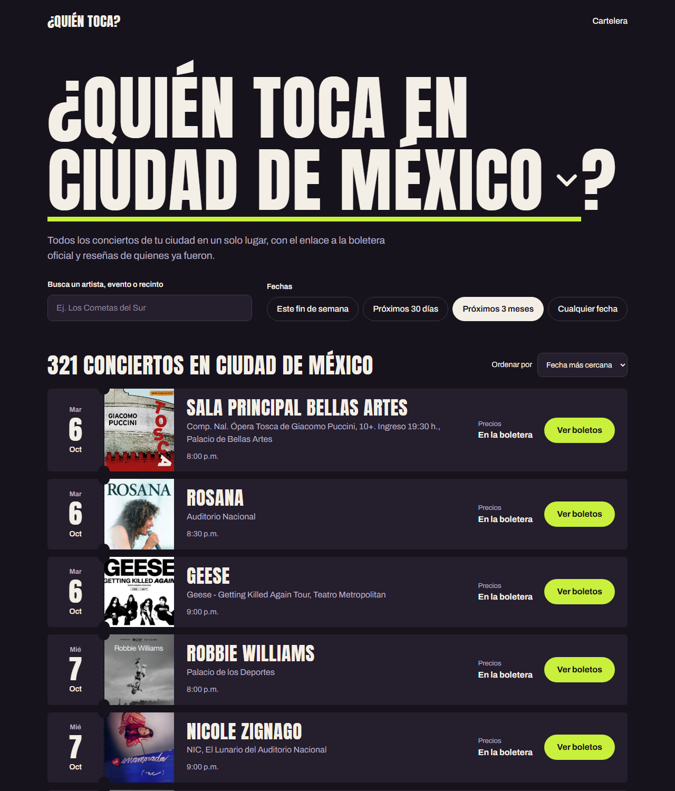
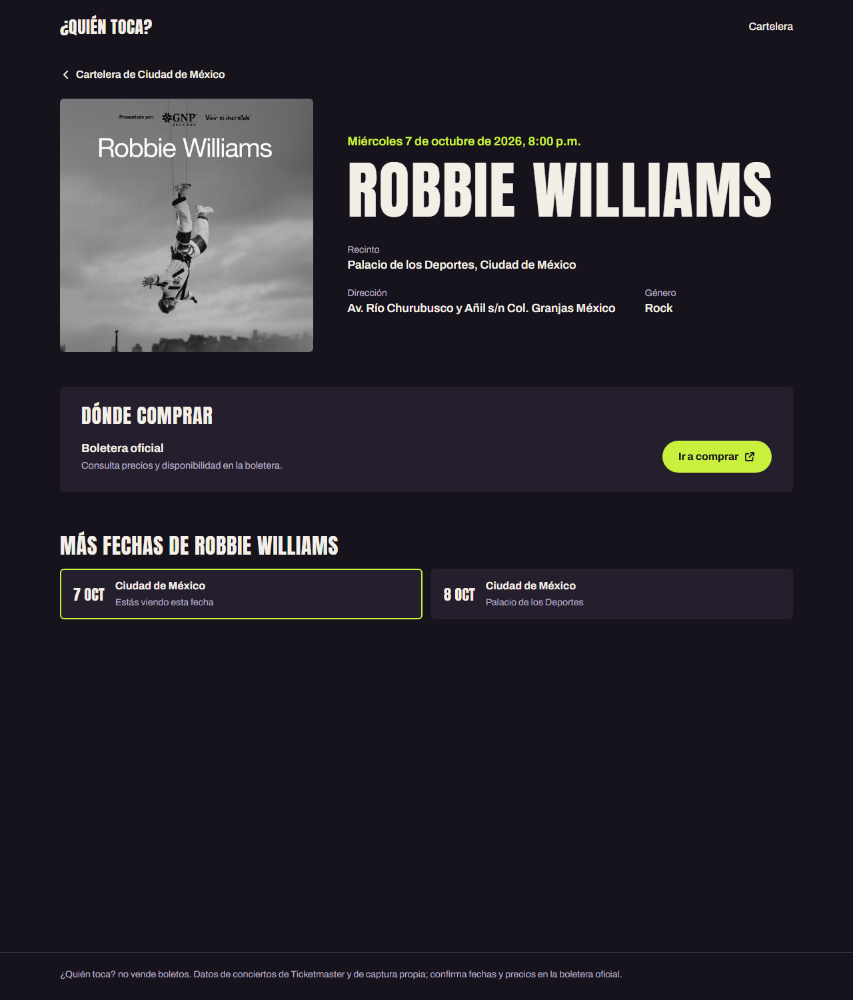
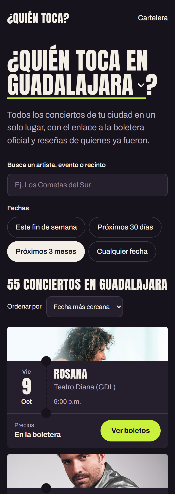
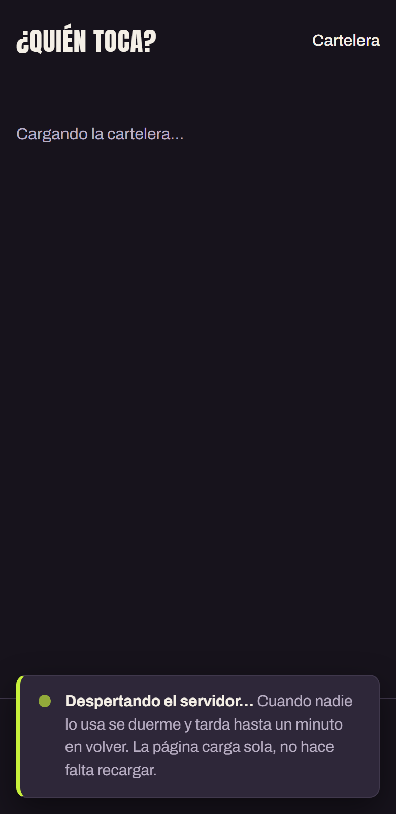

# ¿Quién toca?

Cartelera de próximos conciertos por ciudad (Ciudad de México, Guadalajara,
Monterrey, Puebla y Tlaxcala), con enlace a la boletera oficial y reseñas de
quienes ya asistieron. La app no vende boletos.

Los conciertos llegan cada noche desde la API Discovery de Ticketmaster y
también se pueden capturar a mano desde el panel de administración.

Nombre técnico: `quien-toca`.

| Cartelera | Concierto | En el celular |
|---|---|---|
|  |  |  |

## Arquitectura


- **Frontend** (`frontend/`): React con React Router. La ciudad y el concierto van
  en la dirección (`/cdmx`, `/concierto/<slug>`), así el enlace se puede compartir.
- **Backend** (`backend/`): Django + Django REST Framework. Sirve la API y el panel.
- **Base de datos**: PostgreSQL (búsqueda sin acentos con `unaccent`).
- **Importación**: un comando de Django que corre cada noche en GitHub Actions y
  escribe directo en la base, sin despertar al servidor.

El servidor gratuito de Render se duerme tras 15 minutos sin visitas. Mientras
despierta (~1 minuto) la página muestra un aviso y reintenta sola:



Cómo publicarlo paso a paso: [docs/publicacion.md](docs/publicacion.md).

## Correr el proyecto

Requisitos: Docker Desktop abierto.

```powershell
# 1. Variables de entorno: copia la plantilla y llena los valores vacíos
copy .env.example .env

# 2. Levantar base de datos, backend y frontend (aplica las migraciones al arrancar)
docker compose up

# 3. En otra terminal: crear tu usuario del panel de administración
docker compose exec backend python manage.py createsuperuser
```

| Qué | Dirección |
|---|---|
| Página | http://localhost:5173 (o el puerto de `PUERTO_FRONTEND`) |
| API | http://localhost:8000/api/conciertos/ (o el de `PUERTO_BACKEND`) |
| Panel | http://localhost:8000/admin |

### API

| Endpoint | Parámetros |
|---|---|
| `GET /api/salud/` | — (responde sin tocar la base) |
| `GET /api/ciudades/` | — |
| `GET /api/conciertos/` | `ciudad`, `q`, `desde`, `hasta` (AAAA-MM-DD), `orden` (`fecha`, `precio` o `nota`), `pagina` |
| `GET /api/conciertos/<slug>/` | — (incluye la calificación del artista y del recinto) |
| `GET /api/artistas/` | `q` — perfiles para el buscador (también artistas sin fechas) |
| `GET /api/artistas/<slug>/` | — descripción, redes, fechas próximas y pasadas, estadísticas de reseñas |
| `GET /api/recintos/` | `ciudad`, `q`, `pagina` (solo recintos con conciertos) |
| `GET /api/recintos/<slug>/` | — calificación, conciertos próximos y pasados |
| `POST /api/cuentas/registro/` | `nombre`, `email`, `password` → usuario y tokens |
| `POST /api/cuentas/entrar/` | `email`, `password` → usuario y tokens |
| `POST /api/cuentas/renovar/` | `refresh` → tokens nuevos (el refresh viejo queda anulado) |
| `POST /api/cuentas/salir/` | `refresh` |
| `GET /api/cuentas/yo/` | 🔒 |
| `GET /api/resenas/` | `concierto`, `artista`, `recinto`, `ciudad`, `pagina` |
| `POST /api/resenas/` | 🔒 `concierto`, `general` (1-5), `show`, `sonido`, `puntualidad`, `recinto` (opcionales), `texto` (20+), `asistio` |
| `PATCH`, `DELETE /api/resenas/<id>/` | 🔒 solo quien la escribió |
| `GET /api/resenas/mias/` | 🔒 |
| `POST`, `DELETE /api/resenas/<id>/util/` | 🔒 "Me sirvió" (no en las propias) |
| `POST /api/resenas/<id>/reportar/` | 🔒 `motivo`, `comentario` |
| `POST`, `DELETE /api/artistas/<slug>/seguir/` | 🔒 seguir y dejar de seguir |
| `POST`, `DELETE /api/conciertos/<slug>/guardar/` | 🔒 guardar y quitar |
| `GET /api/mis-conciertos/` | 🔒 `ciudad` (sus fechas van primero) |
| `GET`, `POST /api/sugerencias/` | 🔒 mis sugerencias · sugerir: `artista`, `ciudad`, `recinto`, `fecha`, `hora`, `url_boletos`, `comentario` |

🔒 = con sesión: cabecera `Authorization: Bearer <access>`. El access dura 15 minutos y el
refresh 30 días. Los reportes se revisan en el panel: **Reseñas › Reportes** (acciones
"Aceptar: ocultar la reseña" y "Descartar"). Las sugerencias de conciertos, en
**Sugerencias** (pendientes primero): corrige el nombre si hace falta y usa "Aprobar:
crear el concierto". Si Ticketmaster publica después ese mismo concierto, la
importación lo adopta en vez de duplicarlo.

### Rol Editor: editar desde la página

Quien esté en el grupo **Editores** (en el panel: **Usuarios** › la persona ›
Grupos) ve **Editar** en el menú de la página y puede:

- **Capturar una gira**: el artista, la gira y la boletera una vez, y una fila por
  fecha (ciudad, recinto con autocompletado, día, hora y, si cambian, otra boletera
  o precio). Si el artista o el recinto no existen, se agregan ahí mismo. Si una
  fecha ya existe, se marca y no se guarda ninguna.
- **Agregar artistas** que no están en la cartelera (tienen perfil aunque no tengan
  fechas) y **editar el perfil** de cualquiera: imagen, descripción, artículo de
  Wikipedia y redes. Una descripción escrita a mano queda fija; si se borra, se
  vuelve a buscar en Wikipedia.
- **Editar o cancelar** un concierto (botón **Editar** en su página). En los de
  Ticketmaster solo se cambia lo que la importación no sobrescribe cada noche.
- **Aprobar o rechazar sugerencias**, corrigiendo el nombre si hace falta.
- **Moderar reseñas reportadas**: ocultarlas o descartar el reporte.

El servidor revisa el rol en cada petición (`/api/edicion/…`); sin él responde 403.

### Capturar una gira en el panel

También en el panel, **Conciertos › Capturar gira**: el artista, el nombre de la gira y la
boletera una sola vez, y una fila por fecha (recinto, día, hora y, si cambian,
otra URL o el precio). Se crean todas juntas; si una fecha ya existe se marca y no
se guarda nada hasta corregirla.

### Importar conciertos de Ticketmaster

```powershell
docker compose exec backend python manage.py importar_ticketmaster
docker compose exec backend python manage.py importar_ticketmaster -v 2   # lista los descartados
```

No duplica: si el concierto ya existe lo actualiza, y nunca borra los que ya
pasaron. Los conciertos capturados a mano no se tocan.

### Descripciones de artistas (Wikipedia)

```powershell
docker compose exec backend python manage.py actualizar_descripciones
```

Busca en Wikipedia en español a los artistas nuevos (y renueva cada 30 días):
primero por los enlaces que manda Ticketmaster y, si no, por nombre, aceptando
solo artículos de música con el título idéntico. Si sale la persona equivocada o
no hay artículo, en el panel puedes pegar el artículo correcto o escribir la
descripción a mano (queda fija). Corre cada noche después de la importación.

### Pruebas

```powershell
docker compose run --rm backend python manage.py test
```

En GitHub corren solas en cada push ([`.github/workflows/pruebas.yml`](.github/workflows/pruebas.yml)).

### Comandos útiles de Docker

| Comando | Qué hace |
|---|---|
| `docker compose up -d` | Levanta en segundo plano |
| `docker compose logs -f backend` | Muestra los logs del backend |
| `docker compose down` | Detiene y borra los contenedores (los datos se quedan en el volumen) |
| `docker compose down -v` | Igual, pero **borra también la base de datos** |
| `docker compose build` | Reconstruye la imagen tras cambiar `requirements.txt` |

## Estructura

```
backend/
├── config/              configuración de Django
├── conciertos/
│   ├── models.py        Ciudad, Recinto, Artista, Concierto, PrecioZona
│   ├── admin.py         panel de administración
│   ├── views.py         API REST (serializers.py, urls.py, paginacion.py)
│   ├── importacion/     Ticketmaster (cliente, traducción, importador) y Wikipedia
│   └── tests/           pruebas con respuestas de ejemplo (sin llamar a la API)
├── cuentas/             registro, entrar, salir (JWT con simplejwt)
├── resenas/             Resena, VotoUtil, Reporte; promedios en calificaciones.py
├── seguimiento/         artistas seguidos, conciertos guardados y "Mis conciertos"
├── sugerencias/         conciertos sugeridos y su aprobación (aprobar.py)
└── edicion/             rol Editor (roles.py) y su API: giras, edición, revisiones
frontend/src/
├── App.jsx              rutas
├── api.js               llamadas al backend: sesión JWT y reintentos mientras el servidor despierta
├── contexto/            ciudades compartidas
├── hooks/               usarPeticion, usarCartelera, usarResenas, usarSesion
├── paginas/             Inicio, Concierto, Artista, Recinto(s), Mis conciertos, Sugerir, Entrar/Registro
├── componentes/         Boleto, SelectorCiudad, Taquilla, Cartel, AvisoDespertando...
│   ├── resenas/         Opiniones, TarjetaResena, FormularioResena, Estrellas...
│   ├── perfil/          piezas de las páginas de artista y recinto
│   └── edicion/         Autocompletar, FormularioGira, Revisiones (rol Editor)
├── utilidades/          fechas, rangos, textos
└── estilos/base.css     tokens y estilos del prototipo
.github/workflows/       pruebas en cada push e importación nocturna
render.yaml              configuración del backend en Render
fase0/                   exploración inicial de los datos (ver docs/fase0-hallazgos.md)
docs/diseno/             prototipo visual
docs/publicacion.md      guía de publicación (Neon, Render, Cloudflare Workers)
```
