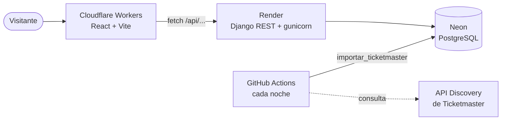

# ¿Quién toca?

Cartelera de próximos conciertos por ciudad (Ciudad de México, Guadalajara,
Monterrey, Puebla y Tlaxcala), con enlace a la boletera oficial y reseñas de
quienes ya asistieron. La app no vende boletos.

Los conciertos llegan cada noche desde la API Discovery de Ticketmaster y
también se pueden capturar a mano desde el panel de administración.

Nombre técnico: `quien-toca`.

| Cartelera | Concierto | En el celular |
|---|---|---|
|  |  |  |

## Arquitectura



- **Frontend** (`frontend/`): React con React Router. La ciudad y el concierto van
  en la dirección (`/cdmx`, `/concierto/<slug>`), así el enlace se puede compartir.
- **Backend** (`backend/`): Django + Django REST Framework. Sirve la API y el panel.
- **Base de datos**: PostgreSQL (búsqueda sin acentos con `unaccent`).
- **Importación**: un comando de Django que corre cada noche en GitHub Actions y
  escribe directo en la base, sin despertar al servidor.

El servidor gratuito de Render se duerme tras 15 minutos sin visitas. Mientras
despierta (~1 minuto) la página muestra un aviso y reintenta sola:


Cómo publicarlo paso a paso: [docs/publicacion.md](docs/publicacion.md).

## Correr el proyecto

Requisitos: Docker Desktop abierto.

```powershell
# 1. Variables de entorno: copia la plantilla y llena los valores vacíos
copy .env.example .env

# 2. Levantar base de datos, backend y frontend (aplica las migraciones al arrancar)
docker compose up

# 3. En otra terminal: crear tu usuario del panel de administración
docker compose exec backend python manage.py createsuperuser
```

| Qué | Dirección |
|---|---|
| Página | http://localhost:5173 (o el puerto de `PUERTO_FRONTEND`) |
| API | http://localhost:8000/api/conciertos/ (o el de `PUERTO_BACKEND`) |
| Panel | http://localhost:8000/admin |

### API

| Endpoint | Parámetros |
|---|---|
| `GET /api/salud/` | — (responde sin tocar la base) |
| `GET /api/ciudades/` | — |
| `GET /api/conciertos/` | `ciudad`, `q`, `desde`, `hasta` (AAAA-MM-DD), `orden` (`fecha` o `precio`), `pagina` |
| `GET /api/conciertos/<slug>/` | — |

### Importar conciertos de Ticketmaster

```powershell
docker compose exec backend python manage.py importar_ticketmaster
docker compose exec backend python manage.py importar_ticketmaster -v 2   # lista los descartados
```

No duplica: si el concierto ya existe lo actualiza, y nunca borra los que ya
pasaron. Los conciertos capturados a mano no se tocan.

### Pruebas

```powershell
docker compose run --rm backend python manage.py test
```

En GitHub corren solas en cada push ([`.github/workflows/pruebas.yml`](.github/workflows/pruebas.yml)).

### Comandos útiles de Docker

| Comando | Qué hace |
|---|---|
| `docker compose up -d` | Levanta en segundo plano |
| `docker compose logs -f backend` | Muestra los logs del backend |
| `docker compose down` | Detiene y borra los contenedores (los datos se quedan en el volumen) |
| `docker compose down -v` | Igual, pero **borra también la base de datos** |
| `docker compose build` | Reconstruye la imagen tras cambiar `requirements.txt` |

## Estructura

```
backend/
├── config/              configuración de Django
└── conciertos/
    ├── models.py        Ciudad, Recinto, Artista, Concierto, PrecioZona
    ├── admin.py         panel de administración
    ├── views.py         API REST (serializers.py, urls.py, paginacion.py)
    ├── importacion/     cliente de Ticketmaster, traducción e importador
    └── tests/           pruebas con respuestas de ejemplo (sin llamar a la API)
frontend/src/
├── App.jsx              rutas
├── api.js               llamadas al backend (reintenta mientras el servidor despierta)
├── contexto/            ciudades compartidas
├── hooks/               usarPeticion, usarCartelera
├── paginas/             Inicio, Concierto, No encontrada
├── componentes/         Boleto, SelectorCiudad, Taquilla, Cartel, AvisoDespertando...
├── utilidades/          fechas, rangos, textos
└── estilos/base.css     tokens y estilos del prototipo
.github/workflows/       pruebas en cada push e importación nocturna
render.yaml              configuración del backend en Render
fase0/                   exploración inicial de los datos (ver docs/fase0-hallazgos.md)
docs/diseno/             prototipo visual
docs/publicacion.md      guía de publicación (Neon, Render, Cloudflare Workers)
```
